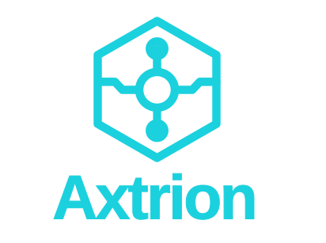

<p align="center">
  <a href="https://github.com/digyna/axtrion" target="blank"></a>
</p>

<p align="center">A reliable, high-performance core for building enterprise-grade server-side applications.</p>

<p align="center">
  <a href="https://central.sonatype.com/artifact/org.digyna.axtrion/axtrion" target="_blank"></a>
  <a href="https://github.com/digyna/axtrion/blob/main/LICENSE" target="_blank"></a>
  <a href="https://github.com/digyna/axtrion" target="_blank"></a>
  <a href="https://github.com/digyna/axtrion" target="_blank"></a>
</p>

## Description

**Axtrion** is a reliable, high-performance core for building enterprise-grade server-side applications. Built on **Spring Boot**, it delivers opinionated conventions, a modular architecture, and production-ready tooling for efficient, scalable development. Its purpose is to serve as a starting point for building modular, scalable, and maintainable enterprise solutions in **Java**, reducing setup time and avoiding the repetition of common configuration tasks.

**Preconfigured initial architecture** based on principles of modularity and separation of concerns.

**Improved productivity**, with utilities, examples, and ready-to-use patterns.

**Built-in best practices**, following quality, security, and maintainability standards.

**Scalability**, designed for both small projects and large enterprise solutions.

**Flexibility**, allowing you to adapt, extend, or replace modules according to your project's needs.

---

With **Axtrion**, you can focus directly on business logic without worrying about initial setup, while having a solid foundation that can evolve into a custom framework or grow alongside your enterprise application.

## Project setup

```bash
# Clean and install dependencies using Maven wrapper
$ ./mvnw clean install
```

## Environment Configuration (`application.properties`)

To configure the application, you can use environment variables or a local configuration file. A template file named **`application.properties.example`** is provided with the required variables.

To create your local configuration from this template, run the following command in the project root:

```bash
# create a local environment file from the example template
$ cp application.properties.example application.properties
```
After that, open the application.properties file and adjust the values according to your environment.

Refer to application.properties.example for a description of each variable and its purpose.

## Maven

If you want to start a new project using **Axtrion** as a library, add the following dependency to your `pom.xml`:

```xml
<dependency>
    <groupId>org.digyna.axtrion</groupId>
    <artifactId>axtrion</artifactId>
    <version>version</version>
</dependency>
```

## Contributing

We welcome and appreciate contributions from everyone interested in helping us improve this project. If you have any ideas, enhancements, or suggestions, we encourage you to open an issue so we can discuss them together. If you think you've got something to help us go forward, feel free to open a pull request.

## Reporting Bugs

If you encounter a bug, please create an issue describing it in detail so we can track and resolve it effectively.

## License

Axtrion is [Apache 2.0 licensed](LICENSE).
